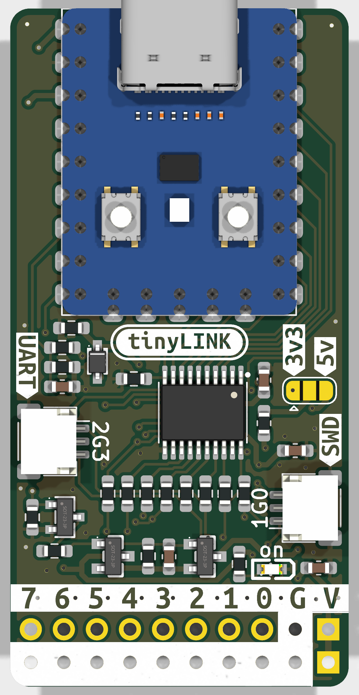
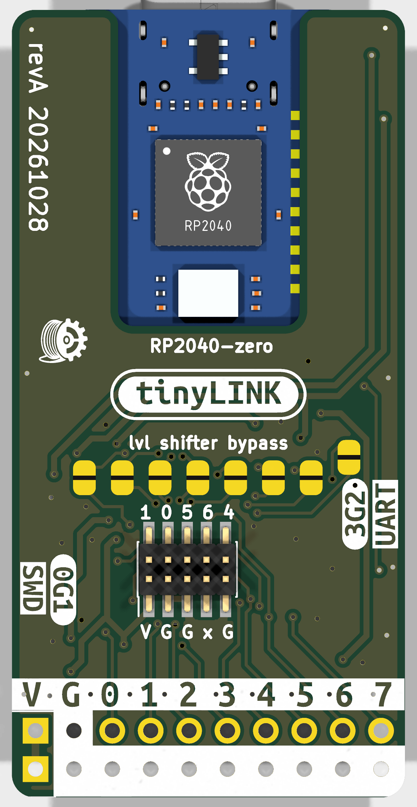
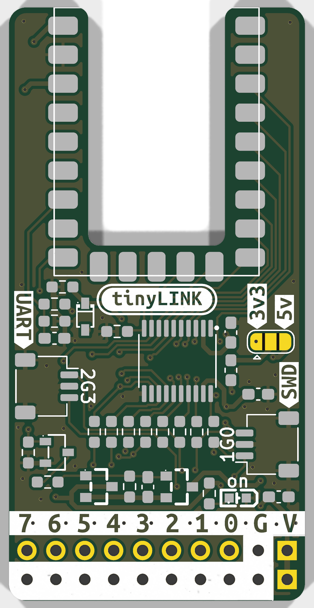
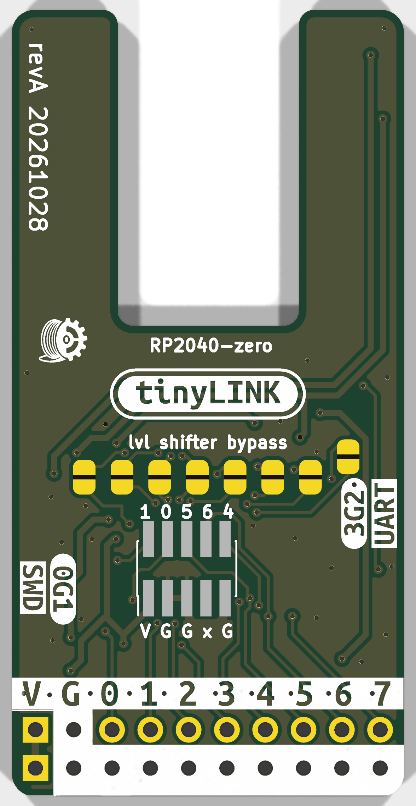
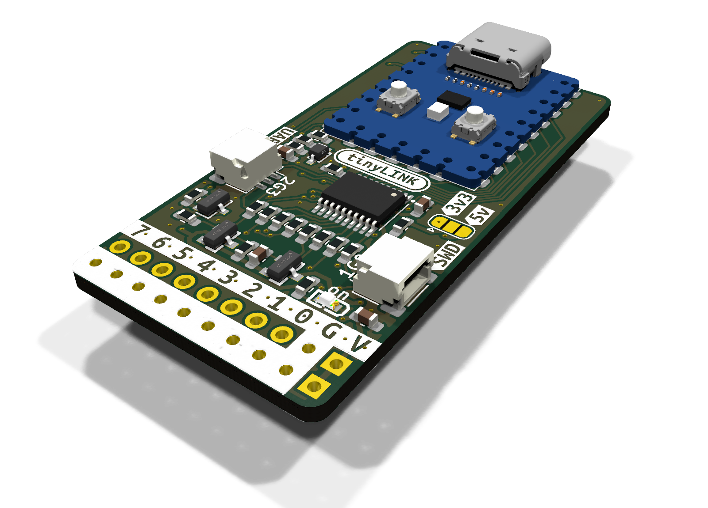

# tinyLINK hardware

Rev A: a 2-layer, 26 × 52 mm carrier for a Waveshare RP2040-Zero, with a U-slot under the module.
KiCad 10 project. Modes, host tools and firmware: [`../firmware/README.md`](../firmware/README.md).

## Renders

| | Front | Back |
|---|---|---|
| Assembled (J3 header not shown) |  |  |
| Bare |  |  |

## Channels

Each of IO0-IO7 runs RP2040 GPIO -> TXS0108E level shifter (U2) -> 33R (R1-R8) -> connectors.

| Ch | GPIO | SWD | WCH | UPDI | UART | LA | SPI | JTAG | ISP |
|----|------|-----|-----|------|------|----|-----|------|-----|
| IO0 | GP2 | SWCLK | | | | CH0 | SCK | TCK | SCK |
| IO1 | GP3 | SWDIO | SWIO | UPDI | | CH1 | MOSI | TMS | MOSI |
| IO2 | GP4 | TX | TX | TX | TX | CH2 | MISO | TX | MISO |
| IO3 | GP5 | RX | RX | RX | RX | CH3 | CS | RX | |
| IO4 | GP6 | nRESET | | | EN (host RTS) | CH4 | | nSRST | RESET |
| IO5 | GP7 | | | | IO0/BOOT (host DTR) | CH5 | | TDO | |
| IO6 | GP8 | | | | | CH6 | | TDI | |
| IO7 | GP9 | | | | | CH7 | | | |

The board also routes WCH RVSWD (IO1 data, IO0 clock) and SWO (IO5, J4 pin 6); firmware support is
planned. GP2-5 are SPI0, GP4-7 are UART1, and GP2-9 are contiguous for PIO.

Other pins: GP10 SHIFT_OE, GP14 TPWR_EN, GP26/ADC0 VTGT_SENSE (VTGT/2 via R12/R13 100k/100k), GP16
WS2812 (on the module). Free: GP0, GP1, GP11-13, GP15, GP27-29.

## Connectors

| Ref | Type | Pinout |
|-----|------|--------|
| J1 | JST-SH 3-pin side entry (Pi debug, SWD) | 1 SWCLK (IO0), 2 GND, 3 SWDIO (IO1) |
| J2 | JST-SH 3-pin side entry (Pi debug, UART) | 1 TX (IO2), 2 GND, 3 RX (IO3) |
| J3 | 2x10 2.54 mm, THT, hand-soldered | odd row: 1 VTGT, 3 GND, 5-19 IO0-IO7; even row (board edge): 2 VTGT, 4-20 GND |
| J4 | 2x5 1.27 mm Cortex Debug, SMD on the back, hand-soldered | 1 VTref, 2 SWDIO/TMS (IO1), 4 SWCLK/TCK (IO0), 6 SWO/TDO (IO5), 8 TDI (IO6), 10 nRESET (IO4), 3/5/9 GND, 7 key |

## Level shifter

U2 needs VCCA <= VCCB (VTGT). VCCA comes from 3V3 through D1 (1N5819WS) as VCCA_SHIFT, estimated at
3.0-3.15 V, with R15 (10k) keeping D1 biased against the A-side pull-up current. That keeps it below
VTGT even on probe-supplied 3V3, so targets need 3.1-5.5 V with U2 fitted. Bench check on the first
boards: with all IOs high on 3V3 target power, VCCA_SHIFT must be below VTGT; if not, fit R15 = 4.7k.

U2's internal pull-ups are about 4 k while high and 40 k while driving low. Avoid external pull-ups
on the shifted lines, or keep them >= 50 k. R14 holds SHIFT_OE low (outputs high-Z) until the firmware
sees VTGT >= 3.1 V.

**3.3 V-only build:** leave U2, C1 and C2 unfitted, close JP1-JP8 (never with U2 fitted) and set
JP9 to 3V3. The IOs are then driven straight at 3.3 V: 3.3 V or 3.3 V-tolerant targets only, never
5 V.

JP1-JP8 sit on the back in one row under "lvl shifter bypass", with no per-channel labels. Seen from
the back, left to right: JP1 (IO0) to JP8 (IO7); JP8 sits slightly higher, next to "UART".

## Target power (VTGT)

VTGT is the target supply output and U2's B-side reference. Its source is set by **JP9**, the 3-pad
jumper on the front at the right-hand edge, just below the module, between U2 and J1. The silk only
says "3v3" and "5v"; a triangle marks pin 1 (left).

- **Ships open:** no target power until you bridge it.
- **3V3:** centre pad to the left pad (1-2, the module's LDO).
- **5V:** centre pad to the right pad (2-3, USB VBUS).
- **Never bridge all three:** that shorts 3V3 to 5V.

Q1/Q2 (AO3401A, back-to-back, so a self-powered target can't back-feed) switch VTGT from GP14 via
Q3, with an R9/R10/C3 soft start and F1 (500 mA PPTC, self-resetting). D2 lights whenever VTGT is
present; dark means JP9 open, F1 tripped or no target power. Firmware behaviour (power-on checks,
fault handling): [`../firmware/README.md`](../firmware/README.md#using-it).

## Known limitations

- Targets below about 3.1 V need the 3.3 V-only build, and their inputs must tolerate 3.3 V.
- On probe-supplied 3V3 the drop across F1 (0.1-0.8 ohm) and Q1/Q2 (~2 x 60 mOhm) eats into the
  level-shifter margin: keep 3V3-powered targets to roughly 100-200 mA, or use 5V or a self-powered
  target for more.
